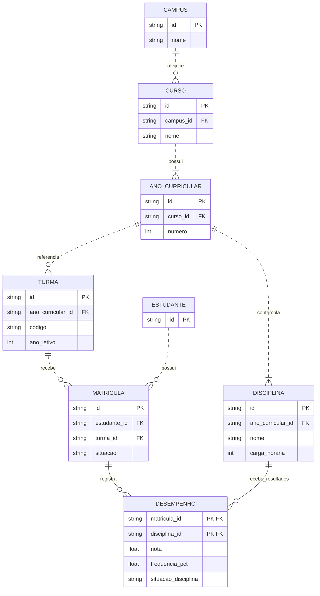
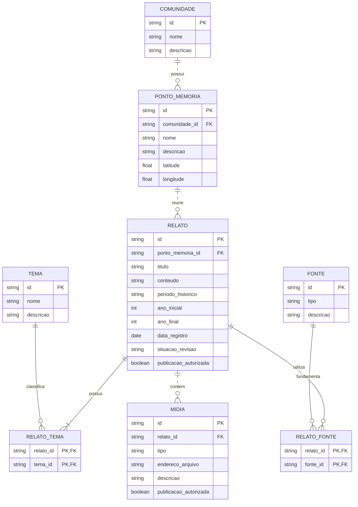

# PPI I — Modelagens consolidadas dos projetos integradores

**IFMA · Campus Itapecuru-Mirim · Técnico em Informática integrado ao Ensino Médio**  
**Versão 1.1 · 24/11/2026 · Referência docente para preparação da Aula 09**

## 1. Finalidade e decisões consolidadas

Este documento consolida os dois modelos discutidos para Prática Profissional Integrada I. Eles servem de base para retomar as atividades de investigação, elicitação e requisitos, estudar modelagem de dados e preparar a avaliação prática.

| Projeto | Objeto central | Questões que o modelo permite investigar |
|---|---|---|
| EDA — Evasão e Permanência Estudantil | Trajetória acadêmica do estudante em um campus | Matrículas, permanência, evasão, notas e frequência por turma, ano curricular, curso e disciplina |
| Mapa de Memórias Quilombolas | Pontos geográficos que reúnem relatos de memória | Localização, história, temas, fontes e mídias de cada relato |

Decisões acordadas:

- O EDA começa no campus e representa a estrutura acadêmica que os estudantes conhecem. O estudante se vincula à turma por sua matrícula anual. Seus resultados por disciplina ficam registrados em Desempenho.
- Memórias começa na comunidade. Cada comunidade pode conter vários pontos de memória, e cada ponto pode reunir histórias de épocas e temas diferentes. Latitude e longitude pertencem ao ponto. Período histórico e temas pertencem ao relato.
- Os dois modelos têm oito entidades. A documentação textual e os diagramas Mermaid podem ser mantidos no próprio projeto Git.
- A aula posterior poderá partir dos modelos e dados fornecidos, com análise, perguntas e revisão assistida por IA. As equipes retomam seus requisitos anteriores para explicar e validar decisões de modelagem.

Os diagramas detalham os modelos conceituais com atributos e chaves, deixando explícita uma possível estrutura lógica relacional. Os nomes técnicos, identificadores, domínios ilustrativos e exemplos abaixo são decisões de documentação para tornar o modelo verificável. As regras operacionais do campus e das comunidades exigem validação com as partes interessadas autorizadas.

## 2. Como ler os diagramas

| Elemento | Significado |
|---|---|
| Entidade | Tipo de objeto ou registro sobre o qual se deseja armazenar dados. |
| Atributo | Informação de uma entidade, como o nome de um curso. |
| PK (chave primária) | Identificador único de um registro. |
| FK (chave estrangeira) | Identificador que aponta para um registro de outra entidade. |
| Duas barras | Exatamente um registro associado. |
| Círculo e pé de galinha | Zero ou vários registros associados. |
| Barra e pé de galinha | Um ou vários registros associados. |
| Entidade associativa | Representa uma relação entre dois registros, podendo guardar informações dessa relação. |
| Linha contínua | Relação identificadora, quando a chave do registro relacionado inclui a chave da entidade de origem. |
| Linha tracejada | Relação em que o registro relacionado possui uma chave primária própria. |

Uma chave composta usa dois atributos em conjunto para identificar unicamente um registro.

## 3. EDA — Evasão e Permanência Estudantil

### 3.1. Contexto e escopo

O modelo representa a organização acadêmica de cursos técnicos integrados, com anos curriculares e turmas em anos letivos específicos. Cada ano curricular possui seu conjunto de disciplinas. A matrícula associa um estudante à turma e registra sua situação naquele ano. O desempenho registra os resultados do estudante nas disciplinas previstas para o ano curricular de sua turma.

**Ano curricular** indica a etapa na estrutura do curso, como o primeiro ou o segundo ano. **Ano letivo** indica o calendário em que a turma funciona, como 2025 ou 2026. Um estudante pode ter matrículas em turmas distintas ao longo de sua trajetória.

### 3.2. Diagrama entidade-relacionamento

### 3.3. Dicionário de dados

| Entidade | Finalidade | Atributos e domínio |
|---|---|---|
| CAMPUS | Unidade de ensino | `id`, identificador; `nome`, texto. |
| CURSO | Curso oferecido pelo campus | `id`; `campus_id`; `nome`, texto. |
| ANO_CURRICULAR | Etapa curricular de um curso | `id`; `curso_id`; `numero`, inteiro positivo. |
| DISCIPLINA | Componente previsto no ano curricular de um curso | `id`; `ano_curricular_id`; `nome`, texto; `carga_horaria`, inteiro positivo em horas-aula, quando informada. |
| TURMA | Grupo de estudantes de um ano curricular em um ano letivo | `id`; `ano_curricular_id`; `codigo`, texto; `ano_letivo`, inteiro. |
| ESTUDANTE | Identidade persistente do estudante | `id`, código sintético que permite acompanhar a trajetória em diferentes matrículas. |
| MATRICULA | Vínculo anual do estudante à turma | `id`; `estudante_id`; `turma_id`; `situacao`, estado da matrícula no recorte analisado. |
| DESEMPENHO | Resultado de uma matrícula em uma disciplina | `matricula_id` + `disciplina_id`, chave primária composta; `nota`, decimal; `frequencia_pct`, percentual de 0 a 100; `situacao_disciplina`, situação acadêmica de exemplo. |

### 3.4. Relacionamentos e regras

| Relacionamento | Regra de modelagem |
|---|---|
| Campus – Curso | Um campus pode oferecer vários cursos. Cada curso do cadastro pertence a um campus. |
| Curso – Ano curricular | Cada curso possui um ou mais anos curriculares. Cada ano curricular pertence a um curso. |
| Ano curricular – Disciplina | Cada ano curricular possui um ou mais componentes curriculares. Cada registro de disciplina refere-se àquele ano curricular. A mesma disciplina nominal pode aparecer em outros anos ou cursos. |
| Ano curricular – Turma | Uma etapa curricular pode ter turmas em diferentes anos letivos e mais de uma turma no mesmo ano. Cada turma referencia uma etapa. |
| Turma – Matrícula | Uma turma pode receber várias matrículas. Cada matrícula pertence a uma turma. |
| Estudante – Matrícula | Um estudante pode realizar diversas matrículas ao longo de sua trajetória. Cada matrícula pertence a um estudante. |
| Matrícula – Desempenho | Cada matrícula pode ter registros de desempenho em diversas disciplinas. |
| Disciplina – Desempenho | Uma disciplina pode receber resultados de diversas matrículas. Cada desempenho referencia uma disciplina e uma matrícula. |

Regras de integridade e recorte:

1. A combinação `curso_id + numero` identifica uma etapa curricular sem duplicidade.
2. A combinação `ano_curricular_id + ano_letivo + codigo` distingue turmas.
3. A combinação `estudante_id + turma_id` identifica um vínculo único no exercício.
4. A combinação `matricula_id + disciplina_id` é única em Desempenho. O vínculo representa um resultado consolidado por disciplina no recorte anual.
5. O ano curricular da disciplina no Desempenho deve coincidir com o ano curricular da turma da Matrícula. Essa condição adicional deve ser conferida na validação do modelo.
6. As notas de exemplo usam a escala de 0 a 10. A frequência usa percentuais de 0 a 100. Dados ausentes permanecem desconhecidos.
7. As situações ilustrativas da matrícula são CURSANDO, CONCLUIU_ANO e EVASAO. A situação da disciplina pode ser EM_ANDAMENTO, APROVADO, REPROVADO ou SEM_RESULTADO_FINAL. As situações vêm do registro acadêmico de referência. Nota ou frequência isoladas não determinam evasão.
8. A estrutura contempla a turma regular do ensino médio integrado. Dependências, mudanças de matriz, equivalências, transferências e notas por etapa poderão ser detalhadas caso os requisitos indiquem essa necessidade.

O vínculo com as disciplinas segue o caminho Estudante → Matrícula → Turma → Ano curricular → Disciplina. Para conhecer o resultado individual de uma disciplina, consultam-se Matrícula e Disciplina por meio de Desempenho.

### 3.5. Dados fictícios para compreender e verificar o modelo

O conjunto abaixo é um novo cenário sintético, construído para a modelagem consolidada. Os nomes de cursos e as disciplinas funcionam como exemplos didáticos. Os registros, cargas horárias, trajetórias e notas são inventados. As listas de componentes são recortes ilustrativos, com duração de curso e matrizes sem pretensão de reproduzir o PPC oficial.

#### CAMPUS

| id | nome |
|---|---|
| C01 | Itapecuru-Mirim |

#### CURSO

| id | campus_id | nome |
|---|---|---|
| CU01 | C01 | Técnico em Informática |
| CU02 | C01 | Técnico em Meio Ambiente |

#### ANO_CURRICULAR

| id | curso_id | numero |
|---|---|---:|
| AC01 | CU01 | 1 |
| AC02 | CU01 | 2 |
| AC03 | CU01 | 3 |
| AC04 | CU02 | 1 |
| AC05 | CU02 | 2 |
| AC06 | CU02 | 3 |

#### DISCIPLINA

| id | ano_curricular_id | nome | carga_horaria |
|---|---|---|---:|
| D01 | AC01 | Matemática | 80 |
| D02 | AC02 | Arte | 40 |
| D03 | AC02 | Biologia | 80 |
| D04 | AC02 | História | 80 |
| D05 | AC02 | Banco de Dados | 80 |
| D06 | AC03 | Redes de Computadores | 80 |
| D07 | AC04 | Geografia | 80 |
| D08 | AC05 | Biologia | 80 |
| D09 | AC05 | Educação Ambiental | 80 |
| D10 | AC06 | Gestão Ambiental | 80 |

#### TURMA

| id | ano_curricular_id | codigo | ano_letivo |
|---|---|---|---:|
| TU01 | AC01 | INFO-1A | 2025 |
| TU02 | AC02 | INFO-2A | 2026 |
| TU03 | AC05 | MA-2A | 2026 |

#### ESTUDANTE

| id |
|---|
| EST001 |
| EST002 |
| EST003 |
| EST004 |
| EST005 |

#### MATRICULA

| id | estudante_id | turma_id | situacao |
|---|---|---|---|
| M001 | EST001 | TU01 | CONCLUIU_ANO |
| M002 | EST002 | TU01 | CONCLUIU_ANO |
| M003 | EST001 | TU02 | CURSANDO |
| M004 | EST002 | TU02 | EVASAO |
| M005 | EST003 | TU02 | CURSANDO |
| M006 | EST004 | TU03 | CURSANDO |
| M007 | EST005 | TU03 | CURSANDO |

#### DESEMPENHO

| matricula_id | disciplina_id | nota | frequencia_pct | situacao_disciplina |
|---|---|---:|---:|---|
| M001 | D01 | 8.0 | 96 | APROVADO |
| M002 | D01 | 7.0 | 92 | APROVADO |
| M003 | D02 | 8.5 | 95 | EM_ANDAMENTO |
| M003 | D03 | 7.0 | 85 | EM_ANDAMENTO |
| M003 | D04 | 5.0 | 78 | EM_ANDAMENTO |
| M003 | D05 | 9.0 | 98 | EM_ANDAMENTO |
| M004 | D02 | 6.0 | 70 | SEM_RESULTADO_FINAL |
| M004 | D03 | 4.0 | 60 | SEM_RESULTADO_FINAL |
| M004 | D04 | 5.0 | 65 | SEM_RESULTADO_FINAL |
| M004 | D05 | 3.0 | 55 | SEM_RESULTADO_FINAL |
| M005 | D02 | 9.0 | 98 | EM_ANDAMENTO |
| M005 | D03 | 8.0 | 94 | EM_ANDAMENTO |
| M005 | D04 | 7.5 | 90 | EM_ANDAMENTO |
| M005 | D05 | 8.5 | 96 | EM_ANDAMENTO |
| M006 | D08 | 8.0 | 93 | EM_ANDAMENTO |
| M006 | D09 | 9.0 | 97 | EM_ANDAMENTO |
| M007 | D08 | 6.0 | 82 | EM_ANDAMENTO |
| M007 | D09 | 7.0 | 87 | EM_ANDAMENTO |

Para M004, os resultados refletem os registros disponíveis antes da evasão. SEM_RESULTADO_FINAL indica ausência de resultado final por disciplina no recorte.

### 3.6. Consultas de referência e resultados esperados

| Pergunta | Caminho ou operação | Resultado na base fictícia |
|---|---|---|
| Quais disciplinas são previstas para TU02? | Turma → Ano curricular → Disciplina | Arte, Biologia, História e Banco de Dados. |
| Quais resultados EST001 possui em 2026? | Estudante → Matrícula M003 → Desempenho → Disciplina | Arte 8,5/95%; Biologia 7,0/85%; História 5,0/78%; Banco de Dados 9,0/98%. |
| Qual foi a trajetória de EST002? | Estudante → Matrículas → Turmas → Anos curriculares | 1º ano de Informática concluído em 2025; matrícula no 2º ano em 2026 com situação EVASAO. |
| Quantas matrículas de evasão aparecem em 2026 por curso? | Matrícula → Turma → Ano curricular → Curso; filtro por ano e situação | Informática 1; Meio Ambiente 0. |
| Qual matrícula de TU02 tem frequência inferior a 75% em Banco de Dados? | Turma → Matrícula → Desempenho com D05; frequência < 75 | M004 (55%). O limite é apenas um filtro de exemplo. |
| Seria válido registrar D09 para M003? | Comparar os anos curriculares da turma e da disciplina | Inválido. M003 está em AC02 e D09 pertence a AC05. |

Os exemplos permitem investigar associações entre situação de matrícula e desempenho. A base didática pequena não sustenta conclusões causais, estatísticas institucionais ou inferências sobre um estudante real.

## 4. Mapa de Memórias Quilombolas

### 4.1. Contexto e escopo

O projeto organiza memórias de comunidades por pontos de interesse histórico ou cultural. Cada **Ponto de Memória** representa um lugar geográfico, com nome, descrição, latitude e longitude. Cada **Relato** representa uma história, acontecimento ou tradição associada ao ponto.

O ponto é compartilhado por relatos que podem tratar de épocas e temas diferentes. O relato possui seu período histórico e a data em que foi registrado. Temas classificam relatos. Fontes sustentam as informações de cada relato e mídias complementam sua documentação.

### 4.2. Diagrama entidade-relacionamento

### 4.3. Dicionário de dados

| Entidade | Finalidade | Atributos e domínio |
|---|---|---|
| COMUNIDADE | Identifica a comunidade a que pertencem os pontos de memória. | `id`; `nome`; `descricao`. |
| PONTO_MEMORIA | Identifica o lugar de referência dos relatos. | `id`; `comunidade_id`; `nome`; `descricao`; `latitude` e `longitude`, coordenadas decimais. |
| RELATO | Registra uma história, prática, acontecimento ou tradição. | `id`; `ponto_memoria_id`; `titulo`; `conteudo`; `periodo_historico`, texto; `ano_inicial` e `ano_final`, inteiros opcionais; `data_registro`, data; `situacao_revisao`, estado; `publicacao_autorizada`, booleano. |
| TEMA | Categoria temática reutilizável. | `id`; `nome`; `descricao`. |
| RELATO_TEMA | Vincula um relato a um tema. | `relato_id` + `tema_id`, chave primária composta. |
| FONTE | Identifica a origem documental ou oral da informação. | `id`; `tipo`, como entrevista ou documento; `descricao`. |
| RELATO_FONTE | Vincula um relato a uma fonte utilizada. | `relato_id` + `fonte_id`, chave primária composta. |
| MIDIA | Recurso que documenta ou ilustra o relato. | `id`; `relato_id`; `tipo`, como fotografia, áudio ou vídeo; `endereco_arquivo`, referência; `descricao`; `publicacao_autorizada`, booleano. |

### 4.4. Relacionamentos e regras

| Relacionamento | Regra de modelagem |
|---|---|
| Comunidade – Ponto de memória | Uma comunidade pode possuir vários pontos. Cada ponto pertence a uma comunidade. |
| Ponto de memória – Relato | Um ponto pode reunir vários relatos de períodos e temas distintos. Cada relato tem um ponto de referência. |
| Relato – Tema | Cada relato possui um ou mais temas. Um tema pode classificar vários relatos. Relato-Tema representa a associação. |
| Relato – Fonte | Um relato pode utilizar várias fontes. Uma fonte pode fundamentar vários relatos. Relato-Fonte representa a associação. |
| Relato – Mídia | Um relato pode possuir diversas mídias. Cada mídia vinculada no exercício pertence a um relato. |

Regras de integridade e recorte:

1. Latitude e longitude ficam no Ponto de Memória. A latitude está entre −90 e 90, e a longitude entre −180 e 180. Os dois valores precisam ser informados em conjunto para representar um ponto no mapa.
2. O período histórico descreve o tempo da história narrada. Os anos inicial e final são opcionais e permitem ordenar ou filtrar a linha do tempo. Quando ambos existem, o inicial deve ser menor ou igual ao final. A expressão textual preserva a incerteza e a forma como o relato data o acontecimento.
3. A data de registro refere-se ao momento da documentação da história. Um relato registrado em 2026 pode descrever um fato de 1975.
4. A combinação `relato_id + tema_id` é única. A combinação `relato_id + fonte_id` também é única.
5. O cadastro pode conter relatos em revisão e sem fonte documentada. Para a publicação simulada, exige-se revisão concluída, ao menos uma fonte e autorização de publicação. Uma mídia exibida publicamente também precisa estar autorizada. As autorizações representam decisões didáticas explícitas e não substituem consentimentos reais.
6. O recorte utiliza um ponto de referência por relato, podendo ampliar a associação a múltiplos pontos caso os requisitos futuros o justifiquem.

### 4.5. Dados fictícios para compreender e verificar o modelo

Este é um novo conjunto sintético, ampliando o exemplo de temas, registros e revisão da Aula 08. Comunidades, pontos, histórias, datas, coordenadas, fontes e mídias são inventados para o exercício. As coordenadas são valores ilustrativos e não identificam a localização de comunidades reais. As referências de mídia representam arquivos hipotéticos.

#### COMUNIDADE

| id | nome | descricao |
|---|---|---|
| CO01 | Comunidade A | Comunidade fictícia do exercício. |
| CO02 | Comunidade B | Comunidade fictícia do exercício. |

#### PONTO_MEMORIA

| id | comunidade_id | nome | descricao | latitude | longitude |
|---|---|---|---|---:|---:|
| P01 | CO01 | Casa de farinha | Local de trabalho comunitário. | -3.390 | -44.350 |
| P02 | CO01 | Praça comunitária | Ponto de encontro e festividades. | -3.392 | -44.352 |
| P03 | CO02 | Caminho antigo | Lugar associado a memórias de circulação. | -3.410 | -44.370 |

#### RELATO

| id | ponto_memoria_id | titulo | conteudo | periodo_historico | ano_inicial | ano_final | data_registro | situacao_revisao | publicacao_autorizada |
|---|---|---|---|---|---:|---:|---|---|---|
| REL01 | P01 | Construção da casa de farinha | História fictícia da construção coletiva. | Década de 1970 | 1970 | 1979 | 2026-08-12 | REVISADO | SIM |
| REL02 | P01 | Tradição da produção de farinha | História fictícia do trabalho e dos saberes transmitidos. | Década de 1980 | 1980 | 1989 | 2026-08-19 | REVISADO | SIM |
| REL03 | P01 | Festa dos produtores de farinha | História fictícia de uma celebração. | 2025 | 2025 | 2025 | 2026-08-26 | EM_REVISAO | NAO |
| REL04 | P02 | Festa tradicional na praça | História fictícia de uma festividade comunitária. | 1995 | 1995 | 1995 | 2026-09-02 | REVISADO | SIM |
| REL05 | P03 | Histórias do caminho antigo | Narrativa fictícia sobre um trajeto de uso comunitário. | Antigamente, sem ano confirmado | — | — | 2026-09-09 | EM_REVISAO | NAO |

#### TEMA

| id | nome | descricao |
|---|---|---|
| T01 | História | Acontecimentos e transformações do passado. |
| T02 | Trabalho | Práticas de trabalho e produção. |
| T03 | Tradição | Saberes e práticas transmitidos entre gerações. |
| T04 | Festa | Celebrações e festividades. |
| T05 | Paisagem | Lugares e caminhos associados à memória. |

#### RELATO_TEMA

| relato_id | tema_id |
|---|---|
| REL01 | T01 |
| REL01 | T02 |
| REL02 | T02 |
| REL02 | T03 |
| REL03 | T03 |
| REL03 | T04 |
| REL04 | T04 |
| REL04 | T03 |
| REL05 | T01 |
| REL05 | T05 |

#### FONTE

| id | tipo | descricao |
|---|---|---|
| F01 | Entrevista | Entrevista fictícia A. |
| F02 | Documento | Documento histórico fictício A. |
| F03 | Entrevista | Entrevista fictícia B. |

#### RELATO_FONTE

| relato_id | fonte_id |
|---|---|
| REL01 | F01 |
| REL01 | F02 |
| REL02 | F01 |
| REL03 | F03 |
| REL04 | F03 |

#### MIDIA

| id | relato_id | tipo | endereco_arquivo | descricao | publicacao_autorizada |
|---|---|---|---|---|---|
| MD01 | REL01 | Fotografia | arquivos/foto-a.jpg | Fotografia fictícia da casa de farinha. | SIM |
| MD02 | REL01 | Áudio | arquivos/audio-a.mp3 | Gravação fictícia sobre a construção. | NAO |
| MD03 | REL02 | Fotografia | arquivos/foto-b.jpg | Fotografia fictícia sobre a produção. | SIM |
| MD04 | REL03 | Vídeo | arquivos/video-a.mp4 | Gravação fictícia da festa. | NAO |
| MD05 | REL04 | Fotografia | arquivos/foto-c.jpg | Fotografia fictícia da praça. | SIM |

### 4.6. Consultas de referência e resultados esperados

| Pergunta | Caminho ou operação | Resultado na base fictícia |
|---|---|---|
| Quantos pontos de memória CO01 possui? | Comunidade → Ponto de Memória | 2: P01 e P02. |
| Quais relatos estão associados à casa de farinha? | Ponto de Memória P01 → Relato | REL01, REL02 e REL03. As coordenadas são as mesmas para os três relatos. |
| Quais relatos tratam de trabalho? | Tema T02 → Relato-Tema → Relato | REL01 e REL02. |
| Quais relatos utilizam a entrevista F01? | Fonte F01 → Relato-Fonte → Relato | REL01 e REL02. |
| Quais fontes fundamentam REL01? | Relato → Relato-Fonte → Fonte | F01 e F02. |
| Quais são os relatos de P01 em ordem histórica? | Relato; ordenar por década ou ano inicial | REL01 (1970–1979), REL02 (1980–1989), REL03 (2025). |
| Quais relatos podem aparecer no mapa público simulado? | Revisão concluída, autorização e pelo menos uma fonte | REL01, REL02 e REL04. |
| Quais mídias de REL01 podem aparecer na consulta pública simulada? | Relato REL01 → Mídia com autorização | MD01. MD02 permanece disponível apenas no acervo interno simulado. |

## 5. Relação entre os dois modelos

| Aspecto | EDA | Memórias |
|---|---|---|
| Estrutura do domínio | Campus, curso, ano curricular e turma | Comunidade e ponto de memória |
| Registro central | Matrícula anual do estudante | Relato histórico ou cultural |
| Relações entre múltiplos registros | Desempenho une Matrícula e Disciplina e armazena resultados da associação. | Relato-Tema e Relato-Fonte unem relatos a categorias e fontes reutilizáveis. |
| Dimensão temporal | Ano letivo da turma | Período histórico e data de registro do relato |
| Dimensão geográfica | Campus como recorte institucional | Latitude e longitude do ponto de memória |
| Consulta demonstrável | Trajetória acadêmica e resultados por disciplina | Mapa, linha do tempo e acervo documental |

## 6. Uso como referência para a Aula 09

**Tema proposto: Do requisito ao modelo de dados — interpretação, exploração e evolução com IA.**

A documentação é uma referência de consulta para os estudantes, com exemplos resolvidos nas seções 3.6 e 4.6. A avaliação pode partir de novos desafios baseados nos mesmos diagramas e registros. Assim a turma trabalha com um contexto familiar e tem tempo para raciocinar sobre o banco de dados.

### Dinâmica proposta para 50 minutos

| Minutos | Atividade | Resultado |
|---|---|---|
| 0–5 | Recuperar uma necessidade ou um requisito das atividades anteriores. Cada equipe escolhe a própria trilha. | Requisito e sua origem identificados. |
| 5–15 | Ler o DER projetado. Comparar entidade, atributo, chave primária, chave estrangeira e cardinalidade nos dois modelos. | A equipe explica uma ligação relevante. |
| 15–27 | Explorar os dados fornecidos e responder perguntas com feedback. Percorrer os relacionamentos até obter os resultados. | Respostas verificáveis e caminhos entre entidades. |
| 27–37 | Debater uma inconsistência apresentada pelo professor e explicar qual regra do modelo ela desrespeita. | Diagnóstico justificado com a tabela e o DER. |
| 37–47 | Evoluir uma pequena parte do DER com IA. Visualizar a alteração em Mermaid, conferir chaves e explicar o motivo. | Trecho de diagrama revisado e justificativa de uma regra. |
| 47–50 | Registrar a entrega e uma explicação individual breve. | Evidência da participação de cada estudante. |

### Exemplos de novos desafios de análise

**EDA.** Uma equipe precisa registrar resultados separados para o primeiro e o segundo bimestres de uma mesma disciplina da mesma matrícula. Pergunte se o identificador composto atual de Desempenho permite dois resultados, quais atributos precisam ser acrescentados ou reorganizados e como preservar a consulta de resultados consolidados. A equipe pode propor uma pequena extensão com uma entidade de resultados por etapa, vinculada a Desempenho, ou justificar outra estrutura equivalente.

**Memórias.** Uma fotografia documenta dois relatos do mesmo ponto de memória. Pergunte se o relacionamento atual permite compartilhar o cadastro da fotografia, como evitar duplicar esse registro e como representar o vínculo com os dois relatos. A equipe pode propor uma associação Relato–Mídia e explicar as cardinalidades. A consulta pública continua dependendo das autorizações do relato e da mídia.

Em ambos os desafios, a equipe consulta o modelo original, propõe a mudança em linguagem natural, pede à IA que gere apenas o trecho Mermaid necessário, confere a representação e demonstra o efeito com dois registros fictícios. O professor pode começar mostrando o exemplo resolvido da trilha oposta.

### Avaliação proposta

A atividade pode valer 4,0 pontos, conforme a proposta de adaptação da PPI1-4B para o último período da disciplina. Uma possibilidade é distribuir 1,0 ponto pela interpretação do modelo, 1,0 pela exploração dos dados, 1,0 pela análise da regra e 1,0 pela alteração justificada com participação individual. A avaliação objetiva pode usar XP e feedback imediato. A alteração aberta e a explicação individual dependem de revisão docente. A distribuição final será definida na preparação da ficha avaliativa.

### Recursos para a aula

- Diagrama completo consultável durante todo o percurso, com foco por entidade e explicação textual.
- Tabelas sintéticas completas das seções anteriores, com consulta por entidade.
- Pequenos exemplos de leitura dos dados e das relações.
- Editor de Mermaid ou arquivo Markdown em Git, com instruções de visualização.
- Prompt curto orientado ao requisito, ao trecho do modelo e à regra que deve ser revista.

Todos os exemplos destinados à turma utilizam dados sintéticos. O tratamento de dados reais de estudantes e de relatos comunitários depende das autorizações e procedimentos institucionais previstos no plano de ensino.

## 7. Referências de contexto e implementação

- IFMA Campus Itapecuru-Mirim. Plano de Ensino de Prática Profissional Integrada I, 2026.2, estrutura SUAP. Seções 4–6, 8 e 9. Documento-base do planejamento da disciplina.
- PPI I. Aula 08 — Da evidência ao requisito. Guia pedagógico com dados sintéticos e dossiê progressivo. [Material da disciplina](https://github.com/thalesvalente/teaching-interdisciplinary-project/blob/main/docs/aula08/GUIA_DOSSIE_PROGRESSIVO.md).
- WATT, Adrienne. *Database Design*. 2. ed. BCcampus, 2014. Capítulo 8, Entity Relationship Data Model. [Livro aberto](https://opentextbc.ca/dbdesign01/chapter/chapter-8-entity-relationship-model/).
- Mermaid. *Entity Relationship Diagrams*. [Documentação da sintaxe](https://mermaid.js.org/syntax/entityRelationshipDiagram.html).
- GitHub Docs. *Creating diagrams*. [Renderização de diagramas no Markdown](https://docs.github.com/en/get-started/writing-on-github/working-with-advanced-formatting/creating-diagrams).

