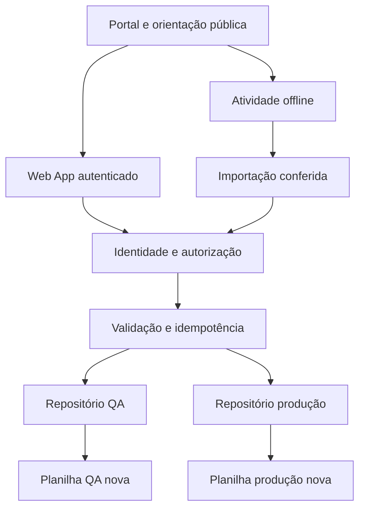

# Arquitetura e decisões — Laboratório Vivo PPI I

## Objetivo e fronteiras

Apoiar atividades de projeto, reflexão individual, submissões versionadas e revisão docente em PPI I 2026.2. O produto da disciplina continua sendo um dossiê de requisitos, modelos, protótipo e validação, conforme o plano fornecido. O laboratório é um meio de acompanhamento; não exige que cada equipe construa um sistema completo.

O portal público apresenta orientação e contingência offline. A interface que grava dados é servida pelo HtmlService de um projeto Apps Script específico por ambiente. Produção e QA têm planilhas, projetos, propriedades, permissões e auditorias separados. As fontes anteriores são só referências de leitura e não participam do caminho de gravação.

Cada implantação configura **um** repositório. O diagrama mostra duas instalações independentes, não seleção de ambiente por parâmetro do navegador.

## Decisões

| Decisão | Motivo | Consequência e limite |
| --- | --- | --- |
| HtmlService + google.script.run | Canal documentado para chamadas ao próprio Apps Script | Site estático não envia fetch cross-origin para /exec; resposta opaque não prova gravação |
| Identidade de sessão + allowlist privada | Não confiar em email/papel/equipe do cliente | Sessão vazia falha fechada; exige teste real na modalidade de implantação |
| Lock de script | Serializar gravações concorrentes do mesmo backend | Não é transação ACID entre abas; falhas parciais exigem estado de reconciliação |
| Ledger por ator, operação e request ID | Replay com recibo estável sem duplicar registros | Payload alterado com mesmo ID é conflito; não sobrescrever envio anterior |
| 15 abas | Separar catálogo, respostas, avaliação, projeção e controle | Usuário opera a interface; abas são infraestrutura protegida |
| Revisão e nota separadas | XP/autodeclaração não atestam aprendizagem nem autoria | Oficialização exige rubrica, plano aprovado e decisão docente |
| Contrato Aula 08 provisório isolado | main inspecionada não tinha o contrato esperado | Núcleo não depende de merge simultâneo; integração da aula permanece pendente |
| Retenção proposta de 90 dias | Reduzir permanência de dados de ensaio | Sem acionamento automático de exclusão; instituição define retenção oficial |

## Fluxo de estudante

Escolher trilha/atividade disponível → consultar roteiro e critérios → registrar achado, hipótese, RF/RNF/dados e aceite → refletir individualmente → salvar rascunho → revisar → enviar → guardar recibo servidor → receber pendência/devolutiva → reenviar como nova revisão. Em contingência, exportar JSON e imprimir/PDF; isso não equivale a envio recebido pelo servidor.

## Fluxo docente

Validar identidade e vínculo mínimos → registrar/ativar versão do catálogo em ambiente autorizado → acompanhar participação e pendências → abrir submissão e conferir evidências → avaliar critérios individualmente → devolver ou propor → aprovar quando autorizado → reconciliar avaliação, projeção de nota e auditoria. Alteração de plano/rubrica nunca retroage silenciosamente.

## Normas como referência de trabalho

| Referência solicitada | Aplicação nesta entrega | Evidência esperada |
| --- | --- | --- |
| ISO/IEC/IEEE 29148 | Requisitos, critérios verificáveis e rastreabilidade | Matriz de aceite, contratos e testes |
| ISO/IEC/IEEE 42010 | Fronteiras, partes interessadas, decisões e vistas | Este documento e modelo de ameaças |
| ISO/IEC 25010 | Adequação, confiabilidade, usabilidade e segurança | Casos funcionais, negativos e UI |
| ISO/IEC 25012 | Consistência, proveniência e integridade de dados | Schema, validações e reconciliação |
| ISO/IEC 27002 | Menor privilégio, controles de acesso e registro | Política de acesso, Properties restritas e auditoria |
| ISO/IEC/IEEE 12207 e 15288 | Fases, verificação, validação e transição controlada | Gates F0–F7 e recibos |

É uma matriz de alinhamento de engenharia, não certificação nem alegação de atendimento integral às normas.

## Fontes técnicas primárias

- [Google — comunicação HtmlService/servidor](https://developers.google.com/apps-script/guides/html/communication): chamadas são assíncronas; usar handlers de sucesso e falha; helpers terminados em underscore não são expostos ao cliente.
- [Google — Session](https://developers.google.com/apps-script/reference/base/session): identidade ativa pode ser indisponível; identidade efetiva pode ser a do proprietário do script.
- [Google — LockService](https://developers.google.com/apps-script/reference/lock/lock-service): `getScriptLock` cobre execuções do projeto; `getDocumentLock` pode retornar null em Web App independente.
- [W3C — WCAG 2.2](https://www.w3.org/TR/WCAG22/): referência para requisitos de acessibilidade, a verificar na interface real.

Consulta técnica realizada em 10/11/2026, America/Fortaleza.
